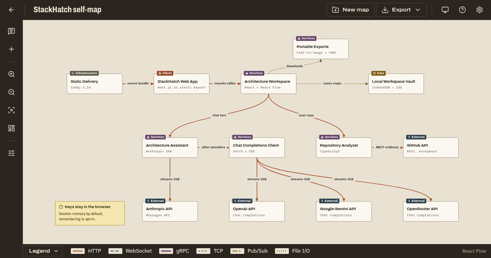

# StackHatch

**Keep your architecture in view.**

StackHatch is a free, open-source architecture map editor. Start from a blank canvas, a Markdown
brief, or a GitHub repository, then edit the map, ask questions about it, and export it.

<p>
  <a href="https://www.stackhatch.io/app"></a>
  <a href="https://www.stackhatch.io"></a>
</p>

[Help](https://www.stackhatch.io/support) · [Privacy](https://www.stackhatch.io/privacy)



## What you can do

- **Start anywhere.** Blank canvas, a requirements file, or a public or private GitHub repository.
- **Edit the map.** Typed nodes, connections, notes, locking, and auto-layout.
- **Ask and compare.** Chat about the architecture, explore alternatives, and generate a PRD.
- **Export.** PNG, SVG, JSON, YAML, Markdown, and backups you can restore later.

Generated maps are explanations based on bounded evidence, not complete code or security audits.
Review them before making production decisions.

## Private by design

- No account, no server database, no analytics, and no StackHatch API.
- Your maps live in your browser's IndexedDB and work offline once the app has loaded.
- GitHub and your AI provider (Anthropic, OpenAI, Google Gemini, or OpenRouter) are called directly
  from your browser, only when you ask. Your API key stays in session memory unless you choose to
  remember it on that device.
- Backups never contain your keys.
- Clearing site data removes your local maps, so export a backup of anything you want to keep.

The full boundary is in the [privacy policy](https://www.stackhatch.io/privacy).

## Run it yourself

Requires Node.js 22+ and npm 10+. No database or server secret is needed.

```bash
npm ci
npm run dev
```

Then open the URL it prints. Add a provider key in Settings only if you want to use AI features;
never put keys in environment files.

To serve the production build in a read-only container:

```bash
docker compose --profile prod up --build
```

It serves a static export with Caddy on port 3000 and accepts no runtime secrets. Put TLS in front
of it when you expose it publicly.

## Contributing

Contributions are welcome; see [CONTRIBUTING.md](CONTRIBUTING.md). Before opening a pull request,
run `npm test`, `npm run typecheck`, `npm run lint`, and `npm run build`. Please report bugs as
GitHub issues without posting keys or private content, and report vulnerabilities through
[SECURITY.md](SECURITY.md).

## License

[MIT](LICENSE)
